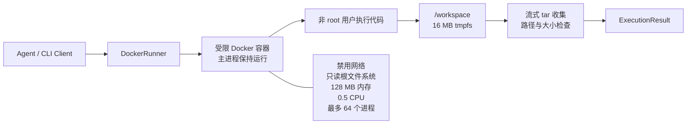

# Agent Code Sandbox

一个供 AI Agent 调用的 Python 代码执行沙箱。用户代码运行在受限 Docker 容器中，服务返回标准输出、标准错误、退出码、超时状态、运行耗时和文件产物。

## 当前架构



## 当前能力

- 执行 Python 代码并返回 `stdout`、`stderr` 和退出码。
- `stdout` 与 `stderr` 合计最多返回 64 KiB；超限时终止容器并返回 `output_truncated=true`。
- 超时后杀死容器并返回 `timed_out=true`。
- 默认禁用网络。
- 默认使用只读根文件系统。
- 限制内存、CPU、进程数，并移除 Linux capabilities。
- 在 16 MB 的临时工作目录中生成文件；最多返回 10 个文件，单文件不超过 1 MB，总计不超过 4 MB。
- 只返回工作目录内的普通文件，跳过符号链接和不合规路径；文件内容使用 Base64 编码。
- 每次执行完成或超时后删除容器。

容器主进程保持运行，以便在用户代码结束后读取 tmpfs；文件收集完成后才删除容器。Docker 的复制归档接口无法读取 tmpfs，因此由容器内的 Python 进程生成 tar 数据流，再由执行器逐项检查。

## 安装

```bash
uv sync
```

Docker Desktop 必须处于运行状态。

## 手动执行

```bash
uv run code-sandbox 'print(2 + 3)'
# 代码自身异常
uv run code-sandbox '1 / 0'

# 执行超时
uv run code-sandbox --timeout 0.2 'import time; time.sleep(5)'

# 输出超限
uv run code-sandbox 'print("x" * 70000)'
```


生成文件产物：

```bash
uv run code-sandbox 'from pathlib import Path; Path("hello.txt").write_text("hi")'
```

示例输出：

```json
{
  "execution_id": "d13f37fc0cf14aa2a626c247741a6327",
  "status": "succeeded",
  "exit_code": 0,
  "stdout": "5\n",
  "stderr": "",
  "duration_ms": 137,
  "artifacts": [],
  "artifacts_skipped": false
}
```

`artifacts_skipped=true` 表示有文件因安全规则或大小限制未被返回；它与用户代码的 `exit_code` 分别报告。
`status` 是执行结果的唯一状态来源：

- `succeeded`：代码正常结束。
- `runtime_error`：代码已经运行，但自身抛出异常或返回非零退出码。
- `timed_out`：超过执行时间限制，容器被终止。
- `output_limit_exceeded`：标准输出和标准错误合计超过 64 KiB，容器被终止。
- `infrastructure_error`：Docker 等执行基础设施发生异常。

`execution_id` 用于关联一次执行的工具结果、日志和排障信息。

## 运行测试

```bash
uv run pytest -q
```

当前测试覆盖：

- 正常执行 Python 代码。
- Python 运行时异常。
- 执行超时后的容器终止。
- 禁止写入根文件系统。
- 禁止网络访问。
- 返回普通文件产物，排除符号链接。
- 跳过超大文件和路径越界的 tar 条目。
- 超量输出时提前终止容器，并测试标准输出和标准错误共用的上限。

## 当前限制

这是第一版 baseline：

- 仅支持 Python。
- 每次请求都创建新容器，没有容器池。
- 还没有 HTTP API、会话文件系统、鉴权和多租户配额。
- 当前版本仍只适合本机实验，不应作为公开服务执行任意代码。
- `duration_ms` 包含容器创建、代码执行和产物收集，不是正式性能压测结论。

后续将增加预热容器池、会话复用、HTTP/MCP 接口和压测报告。
